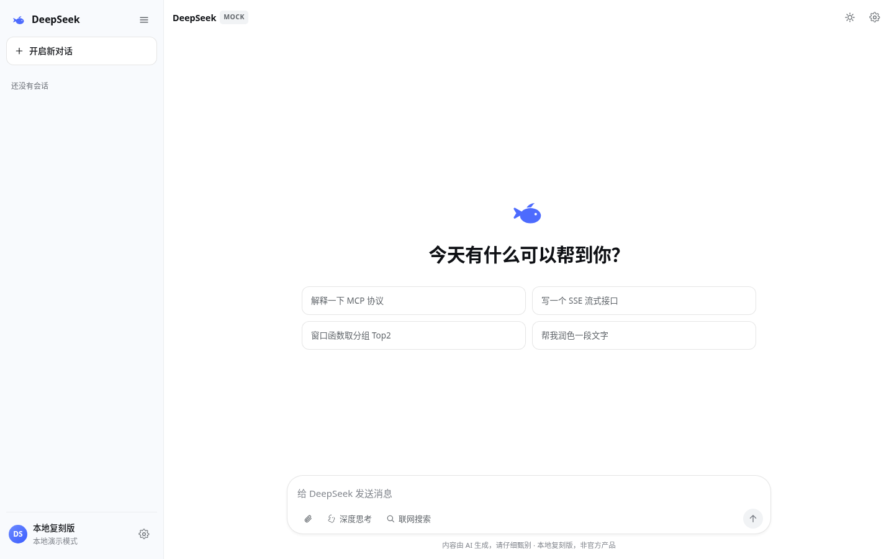

# DeepSeek 网页版复刻

按 `docs/web-analysis.md` 的逆向结果复刻的 DeepSeek 对话界面 + 一个零依赖 Node 后端。
**不是官方产品**，不含官方提示词或密钥；三条通道可切换：本地演示 / 官方 API / 官方 Web 会话。



## 快速开始

```bash
cd webapp
node server.mjs                 # http://127.0.0.1:8787
PORT=8899 node server.mjs       # 换端口（8787 被占用时）
DEEPSEEK_API_KEY=sk-xxx node server.mjs
```

打开页面 → 右上角齿轮 → 选通道：

| 通道 | 需要什么 | 说明 |
| --- | --- | --- |
| `mock` | 无 | 本地演示，完整跑通流式 / 思考块 / 停止生成，不调用任何模型 |
| `api` | `sk-…` | 转发 `api.deepseek.com/chat/completions`，OpenAI 兼容网关也可 |
| `web` | `userToken` | 复刻官方 `/api/v0` 协议：token + PoW 挑战 + SSE 路径补丁 |

## 三条通道怎么走

```
浏览器 ──► /api/chat ──┬─ mock : 本地生成
                        ├─ api  : api.deepseek.com/chat/completions
                        └─ web  : chat.deepseek.com/api/v0/{chat_session/create,
                                                          create_pow_challenge,
                                                          chat/completion,
                                                          chat/stop_stream}
```

### Web 通道（与官方同源逻辑）

1. 前端向 `/api/web/pow` 要挑战（后端带 token 转发 `create_pow_challenge`）；
2. 挑战交给 `/static/pow-worker.js`——**官方 worker 与 sha3 wasm 的原样副本**，
   在浏览器里算出 `answer`；
3. 前端拼 `x-ds-challenge-response = base64(JSON{algorithm,challenge,salt,answer,signature,target_path})`；
4. 后端带该头请求 `/api/v0/chat/completion`，把 `{p,o,v}` 路径补丁解析成文本增量；
5. 停止生成 → `/api/v0/chat/stop_stream`。

PoW 资源改动（相对官方原件）：

| 文件 | 改动 |
| --- | --- |
| `public/static/pow-worker.js` | 仅把 `__webpack_require__.p` 从 `https://fe-static.deepseek.com/chat/` 改为 `/`，让 wasm 从本地取（原文件 sha256 `a28a183c…`，改后 `4d71e494…`） |
| `public/static/8138.63461459c3.js` | worker 运行时所需 chunk，原样 |
| `public/static/sha3_wasm_bg.7b9ca65ddd.wasm` | 原样 |

> 真实挑战需要你自己的账号 token；本仓库不含任何 token，也没有验证过的账号会话。
> 挑战/响应头格式来自 `docs/web-analysis.md` O-04，token 无效时上游返回 `40003`（已实测）。

## 配置

| 环境变量 | 默认 | 说明 |
| --- | --- | --- |
| `PORT` / `HOST` | `8787` / `127.0.0.1` | 监听地址 |
| `DEEPSEEK_API_KEY` | 空 | 官方 Key；为空时前端可在设置面板按请求携带 |
| `DEEPSEEK_BASE_URL` | `https://api.deepseek.com` | 兼容 OpenAI 协议的自建网关 |
| `DEEPSEEK_PROVIDER` | 自动 | `api` / `mock`，缺省按是否有 Key 判断 |
| `DS_SYSTEM_PROMPT` | 空 | 服务端注入的 system 段（官方 Web 同样是服务端注入，见 F-022） |
| `DS_WEB_BASE` | `https://chat.deepseek.com` | Web 通道上游 |
| `SEARCH_ENABLED` | `1` | 联网检索开关 |
| `SEARCH_LIMIT` | `5` | 每次检索取几条 |

前端请求头（只在回环内传递）：`x-deepseek-key`、`x-deepseek-base`、`x-deepseek-token`、`x-ds-pow`。

## 功能

- **会话侧栏**：新建 / 切换 / 删除 / 按「今天 / 昨天 / 近 7 天」分组 / 本地持久化 / 导出 JSON
- **输入区**：Enter 发送、Shift+Enter 换行、自动高度
- **附件**：`.txt .md .json .csv` 与各类代码直接读；`.docx` 解 `word/document.xml`；
  `.xlsx` 读共享字符串；`.pdf` 解 `FlateDecode` 流里的文本；`.zip` 提取其中的文本文件。
  解析结果随消息注入上下文，上限 200k 字符，界面显示「文件名 + 字数」chip
- **深度思考**：`deepseek-reasoner` / `reasoning_content`，折叠面板「已深度思考（用时 N 秒）」
- **联网搜索**：Bing RSS → DuckDuckGo lite 兜底，结果进 system 并回传来源卡片
- **TTS 朗读**：浏览器 `speechSynthesis`，再点一次停止
- **分享**：`POST /api/share` 生成只读页 `/s/<id>`（服务端 Markdown 渲染，落盘 `data/shares.json`）
- **流式**：逐字输出、光标、停止生成、滚动跟随、思考自动折叠、`SET`/`APPEND` 两种补丁语义
- **Markdown**：标题 / 列表 / 表格 / 引用 / 链接 / 行内代码 / 代码块高亮 + 复制 / `$公式$`
- **主题**：浅色 / 深色 / 跟随系统；390px 移动端抽屉式侧栏

## 目录

```
webapp/
  server.mjs               HTTP 路由、SSE、三种通道、上传/分享
  lib/deepseek-web.mjs     官方 Web 通道：token、PoW 头、SSE {p,o,v} 解析
  lib/extract.mjs          附件文本提取（docx/xlsx/pdf/zip/文本）
  public/index.html        结构
  public/styles.css        设计令牌取自官方 main.css（--dsw-*）
  public/app.js            会话、流式、附件、设置、分享
  public/markdown.js       零依赖 Markdown 渲染 + 轻量高亮
  public/pow.js            PoW worker 封装，产出 x-ds-challenge-response
  public/static/           pow-worker.js + chunk + sha3 wasm（见上表）
  data/shares.json         分享副本（运行时生成）
```

## 已知边界

- 没有账号，因此 **Web 通道未做真实对话验证**：挑战、求解、回填头都按官方实现走，
  但只有拿自己的 `userToken` 才能确认端到端；token 无效会得到 `40003`。
- 图片理解、语音输入、原生 TTS 音色、文件云端解析（`/api/v0/file/upload_file`）未复刻：
  前者需要多模态模型，后两者依赖账号侧文件服务。
- 分享是本地副本，不等于官方 `share/create` 的公开链接。
- PoW 求解细节（`difficulty` 语义）仍属台账 F-025 的未知项；此处直接用官方 wasm，
  不自己实现哈希规则。
